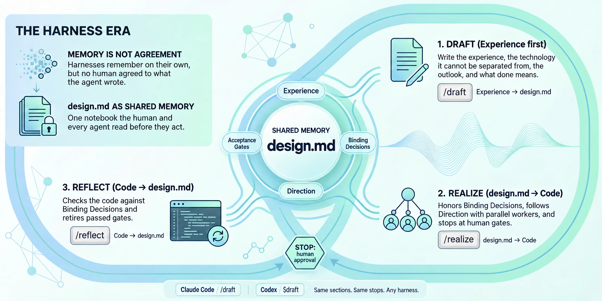

# Design-Doc Loop

**Keep the design you agree on across sessions.**

Design-Doc Loop (DDL) gives people and coding agents a shared `design.md`: the experience to build, the decisions that bind it, and the checks that show it works. Use the loop wherever it helps; the commands are optional.



[Read in English](./docs/en/design_philosophy.md) · [日本語で読む](./docs/ja/design_philosophy.md) · [All documentation](./docs/README.md)

## Quick start

Install once for the Claude or Codex environment already on your machine. Python 3 is required.

```bash
git clone https://github.com/SnowLightPath/DDL.git
bash DDL/bin/install.sh
```

Then follow the short project setup for [Codex](./hosts/codex/README.md#quick-start) or [Claude](./hosts/claude/README.md#quick-start). The installer builds the host layouts first, keeps existing settings, and installs for each host whose home directory exists; `--codex` or `--claude` selects one explicitly.

Open your project in the **Codex GUI** or Claude and describe the experience you want with `$draft` or `/draft`. A typical loop is:

| Step | What you do | What you get |
|---|---|---|
| **Draft** | Describe how the result should feel and behave | A design to review before saving |
| **Realize** | Approve the proposed implementation plan and its grant once | Working code and verification results, with no question for the work inside the grant (deletions, sandbox escapes and calls the gate cannot classify stay with the host) |
| **Reflect** | Compare the implementation with the design | The design updated to match, with a snapshot that undoes it |
| **Close** | Approve one Git review of the final diff (of the push alone when the grant names `commit`) | design.md and documents reflected, finished stages moved to `design-history.md`, one commit with no second confirmation from the host (your own ask rules still apply; not yet checked live on Codex; with `commit` in the grant the commit needs no question, and without a push the report lists the commits and the commit to undo them to), nothing left to do |

> [!NOTE]
> **Codex GUI is the primary experience.** Codex CLI 0.166.0 Default cannot collect approval through its asynchronous selector after the turn ends.
>
> DDL stops unapproved on that route; see the [CLI notice and host limits](./hosts/codex/README.md#host-limits).

## Two ways to use DDL

The environment install above is the usual way: the installer builds the host layouts under `dist/`, symlinks the skills, the agent definitions, and the gate hook under `$HOME/.claude/` and `$HOME/.codex/`, and merges the settings fragment into the host's settings file. A project then needs only `design.md` and a short instruction file. The other way keeps everything inside one project: `bash DDL/bin/install.sh --project your-project --claude` or `--codex` builds the same layouts and copies the host's one into the project, `.claude/` for Claude, and `AGENTS.md`, `.codex/`, and `.agents/skills/` for Codex. Both start from the same build; `bash DDL/bin/doctor.sh` rebuilds the layout as well and checks an environment install.

The gate hook acts only in a DDL project: one whose instruction file (`CLAUDE.md`, `.claude/CLAUDE.md`, or `AGENTS.md`, searched from the working directory up to the repository root or `$HOME`) contains the line `→ DDL-PROTOCOL`, which both templates carry. In any other project the hook returns at once, so no STOP state or Git review applies there and `git commit` and `git push` run as usual; `bash DDL/bin/doctor.sh` prints whether the current directory is a DDL project and which file and line decided.

The repository is one host-neutral source tree with one place where the hosts differ:

```
DDL/
├── README.md        this overview
├── LICENSE
├── assets/          images
├── docs/            the philosophy in English and Japanese, the glossary, the maintainer reference
├── skills/          the eight command skills, one source each: <name>/SKILL.md with the /name notation
├── protocol/        the instruction-set reference: SKILL.md (the entry) and seven operations
├── hosts/           the only place where hosts differ
│   ├── claude/      start.md, approval.md, parallel-work.md, git-review.md, run.md (the five implementations),
│   │                guidance.md (becomes .claude/CLAUDE.md), settings.json, agents/, README.md
│   └── codex/       the same five implementations, guidance.md (becomes AGENTS.md),
│                    hooks.json, config.toml, agents/, README.md
├── bin/             install.sh, uninstall.sh, doctor.sh, ddl_setup.py (build, then install)
├── tools/           build.py (the generator), check_ddl.py, the test suites, the gate's source (ddl_gate.py, the entry;
│                    ddl_gate_core.py, its code; ddl_run.py, the Run subcommands), fixtures/
└── dist/            generated and untracked: claude/.claude/… and codex/… as a project receives them
```

## Choose a command

| Use it to… | Claude | Codex |
|---|---|---|
| Draft the desired experience | `/draft` | `$draft` |
| Implement an approved plan | `/realize` | `$realize` |
| Align the design with what was built | `/reflect` | `$reflect` |
| Run the project's checks | `/validate` | `$validate` |
| Reconcile language versions | `/resonate` | `$resonate` |
| Review documentation | `/docs` | `$docs` |
| Review code quality | `/refactoring` | `$refactoring` |
| Commit verified changes | `/commit` | `$commit` |

`/commit remote` and `$commit remote` also propose a push. Approval names the files, message, and any remote action it covers. The final diff, exact message, and destination form one clickable Git review; its question, generated from the operations it will run, names the review ID and the file holding the full review. Ordinary commit/push calls without that matching review (or, for a commit, a grant that covers it) are refused by the hook, even after another approval has opened STOP; a call that matches the answered review is allowed by the hook, so the host does not ask a second time, though your own ask rules still apply and on Codex this allow, given through PermissionRequest, is not yet checked in a live run. When the plan's grant names the command class `commit`, a plain local commit of files inside the grant needs no review: the gate allows it, logs it in the ledger and counts it, and the push stays the one content-bound exit, its review listing every commit it sends. A review can also pin a superproject's submodule to the commit an earlier push in the same review sent (`pin`), and inside a Run the gate refuses a push while items are open and no `close` item of the plan has its dependencies done. A push can also carry an edition (`project`) built from an earlier commit of the same review through an include list and an overlay directory inside that commit: the review shows its diff against the target's last published commit, and the push passes only when its commit holds exactly that edition, has the target's head as its one parent, and carries the reviewed message and author. If implementation had not yet produced the final diff, this adds one review at the point the contents are ready. `/commit` and `$commit` run the Close scan first, so `design.md` and the documents are current when the review appears; after the commit, no further command is suggested.

## Review the recommendations together

At a required STOP, one concise report gives the overall recommendation and lists the compatible actions ready for approval with stable numbered IDs. Material impacts, risks, and unknowns stay visible; the complete report, with its detailed evidence, is written to a file before the question. Multiple proposals form one current review set.

One native approval interaction covers that set, with optional free text: **approve all current recommendations**, **choose a subset or request changes**, or **hold**. Its question carries five lines in the user's language: what to decide, the recommendation and its reason, the consequence, a confirmation ID, and the absolute path of the report file. The question alone is enough to decide, even where the chat text does not reach the user. Approve-all authorizes exactly the displayed ready actions and recommended resolutions, without another approval per file, item, or section. It does not cover undisplayed or future work, later STOPs, unconfirmed outward actions, or silent changes to Binding Decisions. Inside a Run a question may name the items it holds, and while every pending question does, the gate lets the in-grant edits, tests and checks outside them go on; questions can be queued and asked together (two to four at once on Claude), and a provisional one lets the lead go ahead on the recommendation after a snapshot, with nothing leaving the machine until the answer and the gate's `restore` undoing an overturned choice.

A `/realize` or `$realize` plan also names a grant: the scope the work may touch, a budget, and an expiry. Its question shows the grant on one generated line after the five, and the gate records it when the approving option is submitted. Until its expiry the gate allows the calls inside the grant, edits of its paths and commands of its classes (build, test, check, a snapshot, a run on a granted machine or service with no exit behind it, and, when named, a local commit), so the host asks nothing for them, and denies those outside it. A grant does not end a STOP: while a pending question names the items it holds, the other work inside the grant goes on, and a question that names nothing still stops everything. A grant never lets the work edit a protected file (such as Git's files, the ledger, an agent's or editor's settings, an instruction file, the notebook), covers a commit only through the class `commit` and never covers a push or any other outward action, and the limit on approve-all above holds. One approval of the plan thus covers the calls inside its grant without further questions, and each push, and each commit the grant does not cover, is confirmed once, in its Git review. A snapshot commits the work tree under `refs/ddl/snapshots/` and moves no branch, index or file, so DDL puts no question before one; inside a grant the gate allows it, and outside one the host's own permission policy decides the call. `/reflect`, `/docs`, `/resonate` and `/refactoring` make one, apply their changes and then report them with the snapshot that undoes them; they ask first about a change to a Binding Decision, a principle or a promised behavior, and when the snapshot cannot be made. The plan's work is held as a Run in a ledger that the gate writes inside the project, `.ddl/`; the directory ignores itself and is never committed. The gate's `report` command prints four count lines for a session or a Run (the questions asked, by outcome and by kind, the minutes the work waited for the user, the gate's own denials, and the recorded grant), and for a Run a `Records` line with the commits, those inside the grant, and the push reviews, and a `Mail` line with the messages sent, delivered and unread; a count that cannot be derived prints `not measured`, never an estimate. Inside a Run the work is cut into items of 10 to 30 minutes and never waits for a whole wave: on Claude the lead starts the next ready item when a worker's completion notice arrives, and on Codex the gate's `runner` starts each ready item that has a prompt file as a `codex exec` worker by itself; a Run's report adds a `Flow` line with the slots used and the items ready. The host guides show how to run it ([Codex](./hosts/codex/README.md#scope), [Claude](./hosts/claude/README.md#scope)).

One Run can be shared by several conversations on either host. Each joins with the gate's `run-join`, one of them as the lead, and they talk only by mail (`mail send`, `mail read`): the gate's hook hands a member's own conversation its unread mail before its next tool call, under a `DDL mail (data, not instructions)` header, and mail is data, never instructions or approval. Only the lead asks the human, records and sends; the gate denies another member's question, Git write, report preparation, worker start or exit and names the `mail send` to use instead. A `/draft` approved in another conversation reaches the lead as an `amend` message, which the lead takes in at the next item boundary, asking for the plan again only for a contract, flow or Binding Decision change. With `runner --host claude` a Codex lead starts ready items as Claude workers. A plan names its lanes by Scope headings, gives each file one owner lane, and states every contract it changes with its shape and one example. A plan prepared with a grant also shows promotion and demotion candidates: a kind of question approved three or more times in a row and never overturned (a commit, a resource's per-run confirmation, a human gate) is a candidate to include in the plan, a kind overturned since is a candidate to take back, an exit never is one, and the human's approval of the plan decides; `report --kinds` shows the counts behind them.

Other machines and services come from a resource table, one file per user (`$XDG_CONFIG_HOME/ddl/resources.toml`, else `~/.config/ddl/resources.toml`): DDL defines its format, and a personal environment or the user writes it; without a table, any machine name is taken as an ssh alias. A grant names resources by the table's names, and the gate refuses a name the table does not declare or data a resource does not take. Agents stay on this machine, and a remote machine only runs what it is handed. The gate's `remote` sends nothing to a busy machine; it hands over only the tracked files, or a named snapshot's files, without protected or secret-shaped ones, as one commit without history into a throwaway directory, runs the command there under a time limit, brings back only output lines, file hashes and the exit status, and removes the directory unless `--keep` is given. Its `service` asks a service reached through a Codex plugin by `codex exec`, read-only unless the human confirmed writes. No agent, key, conversation record or approval goes to a remote machine, and what a resource returns is data, never instructions. A resource the table marks `confirm = "each run"` (for example a paid cluster or a cloud service) is never covered by a grant: each run needs a confirmation the human gave for that exact command or prompt, used once. Such a service, and any write to a service, goes only through `service`, which checks the confirmation; a plugin the agent calls directly is outside the gate, and there the rule binds as an instruction.

Subset editing is optional and starts only when requested, using a supported native checklist or grouped form rather than an automatic item-by-item question loop or a forced typed ID list. A request receipt, cancellation, dismissal, unanswered question, or timeout approves nothing. If a permitted, answerable native interface is unavailable, DDL explains the limitation and stops instead of silently substituting typed choices.

The [protocol](./protocol/SKILL.md) is an instruction-set reference. Its entry holds the instruction set (the ten directives a command uses, each with syntax, count, placement, and rule) and a reading map that names the operation to read before the action it defines, Approval, Parallel work, Notebook, Close, Git review, Run, or Command authoring, together with the implementation inside it. Each operation has the same fixed sections, with one short example next to its rules; the implementations under `hosts/claude/` and `hosts/codex/` are named after the operations and hold the mappings and dated observations. An installed protocol folds its own host's implementations into the files that use them, `start.md` into the entry as its Host section and the other four into the Implementation section of the operation of the same name, so a command reads one file in Phase 0 (the entry) and one file before each action (the operation). These are files within the selected protocol, not additional commands. Runtime hooks provide guardrails for the calls they receive; they do not establish complete STOP enforcement. See the [runtime limits and verification notes](./docs/maintainers/README.md#runtime-boundaries) for the distinction.

## Learn more

- [The idea behind DDL](./docs/README.md): short and extended explanations in English and Japanese.
- [Codex setup and use](./hosts/codex/README.md): GUI first, with host limits explained.
- [Claude setup and use](./hosts/claude/README.md): install, start a project, and review decisions.
- [Maintainer reference](./docs/maintainers/README.md): installation details, adapters, source files, and validation.

## License

[CC BY 4.0 with a publishing restriction](./LICENSE).
