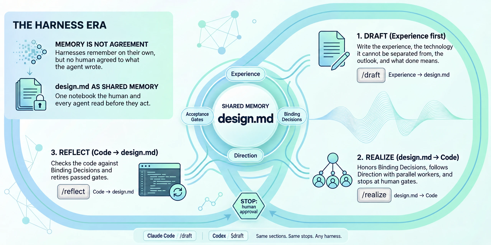

# Design-Doc Loop

**Keep the design you agree on across sessions.**

Design-Doc Loop (DDL) gives people and coding agents a shared `design.md`: the experience to build, the decisions that bind it, and the checks that show it works. Use the loop wherever it helps; the commands are optional.



[Read in English](./docs/en/design_philosophy.md) · [日本語で読む](./docs/ja/design_philosophy.md) · [All documentation](./docs/README.md)

## Quick start

Install once for the Claude or Codex environment already on your machine. Python 3 is required.

```bash
git clone https://github.com/SnowLightPath/DDL.git
bash DDL/bin/install.sh
```

Then follow the short project setup for [Codex](./hosts/codex/README.md#quick-start) or [Claude](./hosts/claude/README.md#quick-start). The installer builds the host layouts first, keeps existing settings, and installs for each host whose home directory exists; `--codex` or `--claude` selects one explicitly.

Open your project in the **Codex GUI** or Claude and describe the experience you want with `$draft` or `/draft`. A typical loop is:

| Step | What you do | What you get |
|---|---|---|
| **Draft** | Describe how the result should feel and behave | A design to review before saving |
| **Realize** | Review the proposed implementation plan | Working code and verification results |
| **Reflect** | Compare the implementation with the design | Proposed updates to keep them aligned |
| **Close** | Approve one Git review of the final diff | design.md and documents reflected, one commit, nothing left to do |

> [!NOTE]
> **Codex GUI is the primary experience.** Codex CLI 0.166.0 Default cannot collect approval through its asynchronous selector after the turn ends.
>
> DDL stops unapproved on that route; see the [CLI notice and host limits](./hosts/codex/README.md#host-limits).

## Two ways to use DDL

The environment install above is the usual way: the installer builds the host layouts under `dist/`, symlinks the skills, the agent definitions, and the gate hook under `$HOME/.claude/` and `$HOME/.codex/`, and merges the settings fragment into the host's settings file. A project then needs only `design.md` and a short instruction file. The other way keeps everything inside one project: `bash DDL/bin/install.sh --project your-project --claude` or `--codex` builds the same layouts and copies the host's one into the project, `.claude/` for Claude, and `AGENTS.md`, `.codex/`, and `.agents/skills/` for Codex. Both start from the same build; `bash DDL/bin/doctor.sh` checks an environment install, including whether the generated layout is current.

The gate hook acts only in a DDL project: one whose instruction file (`CLAUDE.md`, `.claude/CLAUDE.md`, or `AGENTS.md`, searched from the working directory up to the repository root or `$HOME`) contains the line `→ DDL-PROTOCOL`, which both templates carry. In any other project the hook returns at once, so no STOP state or Git review applies there and `git commit` and `git push` run as usual; `bash DDL/bin/doctor.sh` prints whether the current directory is a DDL project and which file and line decided.

The repository is one host-neutral source tree with one place where the hosts differ:

```
DDL/
├── README.md        this overview
├── LICENSE
├── assets/          images
├── docs/            the philosophy in English and Japanese, the glossary, the maintainer reference
├── skills/          the eight command skills, one source each: <name>/SKILL.md with the /name notation
├── protocol/        the instruction-set reference: SKILL.md (the entry) and six operations
├── hosts/           the only place where hosts differ
│   ├── claude/      start.md, approval.md, parallel-work.md, git-review.md (the four implementations),
│   │                guidance.md (becomes .claude/CLAUDE.md), settings.json, agents/, README.md
│   └── codex/       the same four implementations, guidance.md (becomes AGENTS.md),
│                    hooks.json, config.toml, agents/, rules/, README.md
├── bin/             install.sh, uninstall.sh, doctor.sh, ddl_setup.py (build, then install)
├── tools/           build.py (the generator), check_ddl.py, the test suites, ddl_gate.py (the gate's source), fixtures/
└── dist/            generated and untracked: claude/.claude/… and codex/… as a project receives them
```

## Choose a command

| Use it to… | Claude | Codex |
|---|---|---|
| Draft the desired experience | `/draft` | `$draft` |
| Implement an approved plan | `/realize` | `$realize` |
| Align the design with what was built | `/reflect` | `$reflect` |
| Run the project's checks | `/validate` | `$validate` |
| Reconcile language versions | `/resonate` | `$resonate` |
| Review documentation | `/docs` | `$docs` |
| Review code quality | `/refactoring` | `$refactoring` |
| Commit verified changes | `/commit` | `$commit` |

`/commit remote` and `$commit remote` also propose a push. Approval names the files, message, and any remote action it covers. The final diff, exact message, and destination form one clickable Git review. Ordinary commit/push calls without that matching review are refused by the hook, even after another approval has opened STOP. If implementation had not yet produced the final diff, this adds one review at the point the contents are ready. `/commit` and `$commit` run the Close scan first, so `design.md` and the documents are current when the review appears; after the commit, no further command is suggested.

## Review the recommendations together

At a required STOP, one concise report gives the overall recommendation and lists the compatible actions ready for approval with stable numbered IDs. Material impacts, risks, and unknowns stay visible; detailed evidence is available separately. Multiple proposals form one current review set.

One native approval interaction covers that set, with optional free text: **approve all current recommendations**, **choose a subset or request changes**, or **hold**. Approve-all authorizes exactly the displayed ready actions and recommended resolutions, without another approval per file, item, or section. It does not cover undisplayed or future work, later STOPs, unconfirmed outward actions, or silent changes to Binding Decisions.

Subset editing is optional and starts only when requested, using a supported native checklist or grouped form rather than an automatic item-by-item question loop or a forced typed ID list. A request receipt, cancellation, dismissal, unanswered question, or timeout approves nothing. If a permitted, answerable native interface is unavailable, DDL explains the limitation and stops instead of silently substituting typed choices.

The [protocol](./protocol/SKILL.md) is an instruction-set reference. Its entry holds the instruction set (the ten directives a command uses, each with syntax, count, placement, and rule) and a reading map that names the operation to read before the action it defines, Approval, Parallel work, Notebook, Close, Git review, or Command authoring, together with the implementation inside it. Each operation has the same fixed sections, with one short example next to its rules; the implementations under `hosts/claude/` and `hosts/codex/` are named after the operations and hold the mappings and dated observations. An installed protocol folds its own host's implementations into the files that use them, `start.md` into the entry as its Host section and the other three into the Implementation section of the operation of the same name, so a command reads one file in Phase 0 (the entry) and one file before each action (the operation). These are files within the selected protocol, not additional commands. Runtime hooks provide guardrails for the calls they receive; they do not establish complete STOP enforcement. See the [runtime limits and verification notes](./docs/maintainers/README.md#runtime-boundaries) for the distinction.

## Learn more

- [The idea behind DDL](./docs/README.md): short and extended explanations in English and Japanese.
- [Codex setup and use](./hosts/codex/README.md): GUI first, with host limits explained.
- [Claude setup and use](./hosts/claude/README.md): install, start a project, and review decisions.
- [Maintainer reference](./docs/maintainers/README.md): installation details, adapters, source files, and validation.

## License

[CC BY 4.0 with a publishing restriction](./LICENSE).
