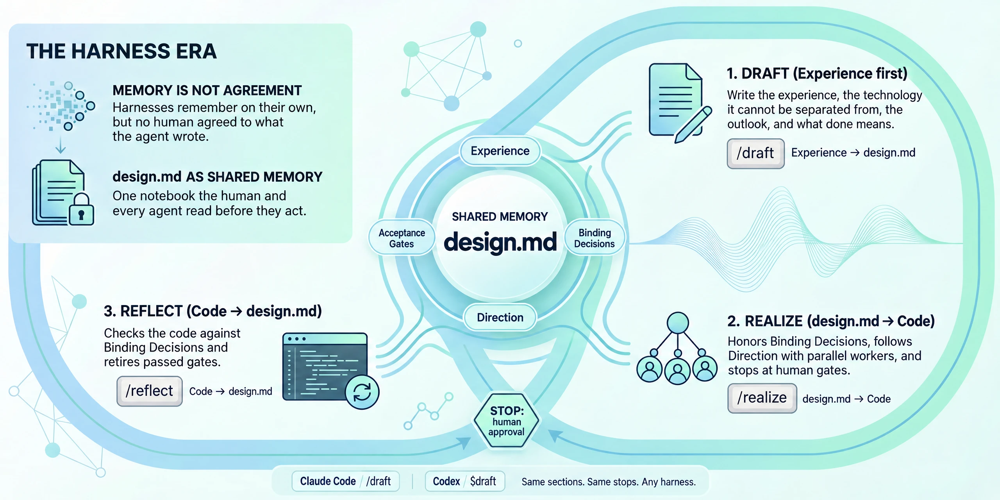

# ✨ Design-Doc Loop (DDL)

> Human and LLM share design across sessions.



---

## 🎯 The Problem

- Sessions end, and the next session starts without what this one knew
- What the agent remembers, the human never agreed to
- Context is a budget: the more a session holds, the less the model recalls

## 💡 The Solution

Use Design Documents as shared memory.

```
Human ←→ Design Document ←→ LLM
                ↓
              Code
```

## 🔄 The Loop

```
      Draft
        ↓
Design Document ⇄ Code
   (Realize ↓  ↑ Reflect)
```

| Phase | Flow |
|-------|------|
| 📝 **Draft** | Idea → Design Document |
| ⚡ **Realize** | Design Document → Code |
| 🪞 **Reflect** | Code → Design Document |

Realize and Reflect are inverse functions.

---

## 📚 Documentation

- [English](./docs/en/design_philosophy.md)
- [日本語](./docs/ja/design_philosophy.md)（[用語集](./docs/ja/GLOSSARY.md)）

## 🛠️ Commands (Optional)

DDL ships as skills for Claude Code and OpenAI Codex, with an adapter that lets the runtime itself hold a STOP until you speak, keep workers in their roles, load design.md at session start, and ask before a push.

### 📦 Install

**In the environment** (recommended). One clone serves every project:

```bash
git clone https://github.com/SnowLightPath/DDL.git
bash DDL/bin/install.sh
```

`install.sh` installs for each runtime whose home directory exists (`~/.claude`, `~/.codex`; `--claude` or `--codex` selects one): it symlinks the nine skills (the eight commands and `ddl-protocol`), the `explorer` and `worker` agents, the gate hook, and for Codex the `git push` rule file (`rules/ddl.rules`) into the runtime's home, and merges the DDL fragment into its settings (`~/.claude/settings.json`, `~/.codex/hooks.json`), keeping what is already there. The Codex `[agents]` cap is not installed: set `max_concurrent_threads_per_session = 5` in `~/.codex/config.toml` yourself. `--dry-run` prints the actions without performing them. The scripts require `python3` (standard library only), which the gate hook also needs; without it the hook fails open and the rules hold as instructions. `bash DDL/bin/doctor.sh` checks the install; `bash DDL/bin/uninstall.sh` removes it. To update, `git pull` in the clone (the links follow) and run `install.sh` again when the settings fragment changed; it is idempotent, so running it every time is harmless. If Codex asks, run `/hooks` once to trust the DDL hooks.

A project then needs only `design.md` and a short instruction file:

```bash
mkdir -p your-project/.claude && cp DDL/claude-code/CLAUDE.md your-project/.claude/CLAUDE.md   # Claude Code (edit the `# Project Name` title)
cp DDL/codex/AGENTS.md your-project/AGENTS.md                                                  # Codex
```

**In the project.** Copy the runtime's files into the project (`bash DDL/bin/install.sh --project your-project` makes the same copy, skipping the READMEs and keeping an existing instruction file):

```bash
cp -R DDL/claude-code/{CLAUDE.md,settings.json,agents,hooks,skills} your-project/.claude/   # Claude Code
cp -R DDL/codex/{.agents,.codex,AGENTS.md} your-project/                                    # Codex
```

Claude Code runs project hooks after you trust the folder. Codex loads `.codex/` for a trusted project and runs its hooks after `/hooks` trusts them.

Either way, the rules are the same without the adapter, as instructions; the adapter enforces the mechanical part. A command run from the environment install follows the project's own copy when the project has one.

### 🤖 Claude Code

**🔄 Core Loop:**

| Command | Action |
|---------|--------|
| 📝 `/draft` | Idea → Design Document |
| ⚡ `/realize` | Design Document → Code |
| 🪞 `/reflect` | Code → Design Document |

**🧩 Support Commands:**

| Command | Action |
|---------|--------|
| ✅ `/validate` | Mechanical validation gate |
| 🌐 `/resonate` | Multilingual docs sync |
| 📦 `/commit` | Verified git commit (`/commit remote` also pushes) |
| 📚 `/docs` | Documentation audit |
| 🔧 `/refactoring` | Code quality audit |

> 🚀 Commands support Phase-based workflows, Detection Targets, STOP gates, and parallel workers per scope through the runtime's own mechanism (subagents in Claude Code). The adapter (`settings.json`, `agents/`, `hooks/`, and the import line in `CLAUDE.md`) lets Claude Code itself hold a STOP until you speak, keep workers in their roles, load design.md at session start, and ask before a push; without it the same rules run as instructions.

### 🧬 OpenAI Codex

**🔄 Core Loop:**

| Skill | Action |
|-------|--------|
| 📝 `$draft` | Idea → Design Document |
| ⚡ `$realize` | Design Document → Code |
| 🪞 `$reflect` | Code → Design Document |

**🧩 Support Skills:**

| Skill | Action |
|-------|--------|
| ✅ `$validate` | Mechanical validation gate |
| 🌐 `$resonate` | Multilingual docs sync |
| 📦 `$commit` | Verified git commit (`$commit remote` also pushes) |
| 📚 `$docs` | Documentation audit |
| 🔧 `$refactoring` | Code quality audit |

> Skills follow the same Phase-based structure with Detection Targets and STOP gates. Codex runs scopes in parallel with its subagents (on by default). Without subagents, the lead runs the assignments itself: read-only work as parallel shell reads, the rest one by one. The adapter (`.codex/`: `config.toml`, `agents/`, `hooks.json`, `hooks/`, `rules/`) lets Codex hold a STOP until you speak, inject design.md at session start, and ask before a push; without it the same rules run as instructions.

---

## 📄 License

[CC BY 4.0](./LICENSE) with publishing restriction
