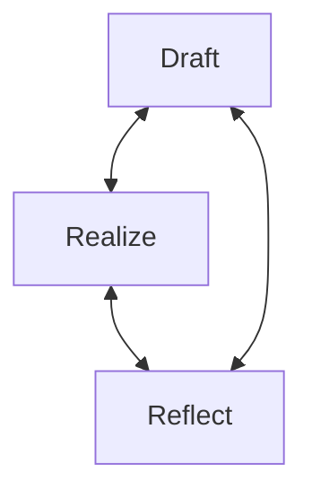
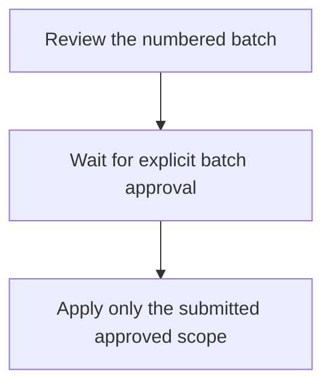
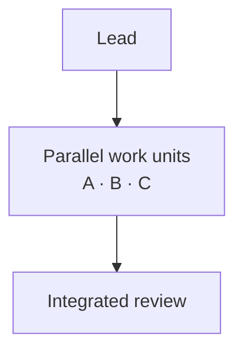

# Design-Doc Loop: Detailed guide

The reasoning, trade-offs, and longer examples behind DDL. For everyday use, start with the [core guide](./design_philosophy.md) or the [Claude](../../hosts/claude/README.md) and [Codex](../../hosts/codex/README.md) setup guides.

**English** · [日本語](../ja/design_philosophy_extended.md)

## How to Read

This document is intended for dictionary-style lookup.

| Goal | Section |
|------|---------|
| Understand theoretical background | [§1 Cognitive Foundations](#1-cognitive-foundations) |
| Compare with existing methodologies | [§2 Related Methodologies](#2-related-methodologies) |
| See what the model loads and when | [§2.5 Context Engineering](#context-engineering) |
| See which rules the harness enforces | [§2.5 Instructions and Mechanisms](#instructions-and-mechanisms) |
| Systematize operations | [§3 Systematization Framework](#3-systematization-framework) |
| Get concrete examples | [§4 Practical Examples](#4-practical-examples) |
| Make adoption decisions | [§5 Adoption Criteria](#5-adoption-criteria) |
| Measure effectiveness | [§6 Metrics](#6-metrics) |
| Choose how to implement DDL | [§7 Implementation Options](#7-implementation-options) |
| Manage artifacts and their lifecycle | [§8 Artifacts and Lifecycle](#8-artifacts-and-lifecycle) |

No need to read cover-to-cover. Pick what you need.


## §1 Cognitive Foundations

DDL intersects with several cognitive science and philosophy theories. These are not post-hoc rationalizations but frameworks referenced during design.

### 1.1 Extended Mind

Clark & Chalmers (1998) proposed "Extended Mind"—the claim that cognition doesn't complete in the brain but integrates with external tools.

The famous **Inga/Otto thought experiment**: Inga remembers the museum address in biological memory; Otto, with Alzheimer's, records it in a notebook. Clark argued Otto's notebook is **functionally equivalent** to Inga's memory (Clark & Chalmers, 1998; Clark, 2008).

design.md in DDL corresponds to "Otto's notebook."

| Functional Equivalence Criteria | Otto's Notebook | design.md |
|--------------------------------|-----------------|-----------|
| Always available | Always carried | Lives in repository |
| Directly accessible | Quick to reference | Loaded at session start |
| Automatically trusted | Followed without doubt | Respected as design principles |
| Consciously recorded in past | Intentionally noted | Explicitly recorded via Draft/Reflect |

This table is DDL's design rationale. By satisfying these 4 conditions, design.md functions as "extended memory" for the Human-LLM system.

**Harness memory is not the notebook.** Agent harnesses now keep memory of their own: instruction files, automatic memory, summaries of long conversations, progress files written for the next session. For the agent, that memory meets the first two conditions. For the human, what the agent wrote there usually fails the fourth: the agent wrote it, and the human never consciously endorsed it. design.md is the part both sides have agreed to. The two complement each other; neither replaces the other.

```
Traditional: Brain -> Thinking -> Action

DDL:  Human Brain <-> design.md <-> LLM
                  |
          One cognitive system
```

### 1.2 SECI Model

Nonaka's SECI model (Nonaka & Takeuchi, 1995; Nonaka, Toyama, & Konno, 2000) describes conversion cycles between tacit and explicit knowledge.

```
+---------------+---------------+
|  Socialization| Externalize   |
|    (share)    |  (articulate) |
| Tacit -> Tacit| Tacit -> Form |
+---------------+---------------+
| Internalize   | Combination   |
|   (embody)    | (systematize) |
| Form -> Tacit | Form -> Form  |
+---------------+---------------+
```

DDL correspondence:

| Phase | DDL Example |
|-------|-------------|
| Socialization | Share "something like this" through Human-LLM dialogue |
| Externalization | Articulate experience in Draft |
| Combination | Structure design.md, organize relationships between principles |
| Internalization | Restore context by reading design.md in next session |

SECI has been criticized for "weak empirical grounding" (Gourlay, 2006). DDL addresses this by presenting concrete, practice-verifiable methods.

### 1.3 Distributed Cognition

Hutchins (1995) proposed "Distributed Cognition"—the view that cognition is distributed across teams, tools, and environments.

Flor & Hutchins (1991) analyzed pair programming and showed that the system as a whole has cognitive properties distinct from individual programmers. DDL explicitly designs this distributed structure.

```
  Human <-------> Document <-------> LLM
    |                |                |
 Intuition       Shared           Pattern
 Long-term       Memory           Recognition
 Values          Persist          Tech Knowledge
```

Where to delegate what—this awareness is DDL's core.

### 1.4 Human-AI Collaboration Research

Research on LLM collaboration has surged in 2024-2025.

**Session Discontinuity Problem**: Chat assistants gained memory years ago, and coding harnesses now add their own: instruction files, automatic memory, compaction of long conversations. The problem DDL addresses is not that the model forgets. It is that what the harness remembers is not something the human agreed to; that it is not shared across agents and harnesses (whether a SWARM worker inherits the lead's conversation depends on the runtime and on how the worker is started); and that it is finite, because the more a context holds, the worse the model recalls any of it (Anthropic, 2025b). design.md answers all three: it carries only what the human agreed to, every session reads the same file, and the lead builds each worker's prompt from it, so five workers running in parallel need nothing beyond what their prompts say.

**LLM as Cognitive Extension**: Sabbah & Li (2025) argue that LLMs can compensate for human bounded rationality.

| Human Constraint | LLM Compensation | DDL Realization |
|-----------------|------------------|-----------------|
| Bounded rationality | Exhaustive exploration | Expand options in Draft |
| Satisficing | Optimal solution pursuit | Check against principles in Realize |
| Uncertainty avoidance | Risk assessment | Discuss in dialogue |

LLMs don't replace humans—they complement. DDL structures this complementary relationship.


## §2 Related Methodologies

DDL overlaps with existing methodologies. To avoid reinventing wheels, we clarify differences.

### 2.1 Documentation-Driven Development (DocDD)

In the lineage of Knuth's Literate Programming (1984). Based on the insight: "What's hard to explain is poorly designed."

| Aspect | DocDD | DDL |
|--------|-------|-----|
| Direction | One-way (Doc→Code) | Bidirectional (Doc⇄Code) |
| Purpose | Finalize specifications | Maintain shared memory |
| Persistence | Documents are deliverables | Documents are temporary |

### 2.2 Architecture Decision Records (ADR)

Popularized by Nygard (2011). Records design decisions and their rationale.

| Aspect | ADR | DDL |
|--------|-----|-----|
| Timing | Post-decision (static) | During decision (dynamic) |
| Updates | Append-only | Rewritable |
| Granularity | Architecture level | Concept to implementation |

Promoting DDL documents to ADR once stable is a valid workflow.

### 2.3 Test-Driven Development (TDD)

Core practice of XP by Beck (1999).

| Aspect | TDD | DDL |
|--------|-----|-----|
| Define first | Tests | Experience (ideal API) |
| Feedback loop | Red→Green→Refactor | Draft→Realize→Reflect |

TDD and DDL are orthogonal and can coexist. Draft → Test → Implement is a natural flow.

### 2.4 Design by Contract (DbC)

Formalized by Meyer in Eiffel (Meyer, 1992). Makes contracts (invariants) explicit.

| Aspect | DbC | DDL |
|--------|-----|-----|
| Level | Code (executable) | Design policy (conceptual) |
| Enforcement | Runtime checks | Discipline and dialogue, with the harness enforcing the mechanical part where its adapter can (§2.5) |

### 2.5 AI-Era Development Paradigms (2025–2026)

Three structured approaches to AI-assisted development emerged in 2025–2026, each from a different origin and solving a different problem.

| Origin | Paradigm | Core Problem |
|--------|----------|-------------|
| Product development | Spec-Driven Development (SDD) | AI generates wrong code without specs |
| Enterprise development | AI-Driven Development Life Cycle (AI-DLC) | SDLC doesn't account for AI as primary executor |
| Research / exploratory development | Design-Doc Loop (DDL) | Design intent is lost across sessions |

All three share a common background: unstructured AI coding ("vibe coding") doesn't scale. Each structures the Human-AI relationship differently.

#### SDD in Brief

Write specifications in natural language, then let AI generate code from them. Not one methodology—multiple tools (GitHub Spec Kit, Kiro, Tessl) differ significantly (Thoughtworks, 2025; Fowler et al., 2025). The spec is the source of truth; code is derived.

#### AI-DLC in Brief

AWS-originated methodology (Raja SP et al., 2025) that redesigns the entire SDLC with AI as primary executor. Three phases: Inception (mob elaboration → requirements), Construction (mob construction → code), Operation (AI-monitored deployment). Redefines agile terminology: sprints → bolts (hours/days), epics → units of work. Human role: validate and approve AI proposals.

#### Harness Engineering in Brief

In 2025–2026 the harness around the model became an engineering subject of its own. Anthropic described a harness for long-running agents in which an initializer agent sets up the environment, and each later session reads a progress file, a feature list, and the git log before choosing its work (Anthropic, 2025a). OpenAI's harness engineering report describes a product built with no manually written code: engineers design the environment, specify intent, and build feedback loops, while Codex writes the code (Lopopolo, 2026).

Of everything these harnesses record and specify, DDL addresses the part the human must agree to: the experience, the decisions that bind it, and the gates where the human looks.

#### Context Engineering

By late 2025 the discipline had a name. Anthropic's applied AI team described context as "a finite resource with diminishing marginal returns": as the window fills, the model recalls less of what is in it, so an agent should hold the smallest set of high-signal tokens that lets it act, retrieve the rest just in time, compact long conversations into summaries, and give focused sub-agents clean context windows (Anthropic, 2025b). Agent Skills apply the same idea to instructions: at startup only each skill's name and description load, and the body loads when the skill is used (Anthropic, 2025c). Manus reports the same lessons from production: treat the file system as context that is unlimited and persistent, keep the record of wrong turns, and recite the current objectives into the end of the context (Ji, 2025). The harnesses document what they load. Claude Code loads the user and project instruction files and its automatic memory at session start, loads a command when it is invoked, and after compaction re-injects the project instruction file and the memory from disk while the conversation itself is summarized (Anthropic, 2026). Codex reads the AGENTS.md chain once per run before any work, lists skills by name and description, and treats memories as "a helpful recall layer, not as the only source for rules that must always apply" (OpenAI, 2026).

DDL is context engineering done from the human's side. The question "what should the model see before it acts" splits into what is always in context, what loads when a command runs, and what the lead packs for each worker:

| Layer | Content | Loaded | Owner |
|-------|---------|--------|-------|
| Instruction file (`CLAUDE.md`, `AGENTS.md`) | How to work here: protocol lookup, global constraints, G1–G7 | Session start; Claude Code re-injects the project file after compaction | Human |
| design.md | What the human agreed to: Experience, Binding Decisions, Direction, Acceptance Gates, principles, scopes, validation | Session start; the adapter re-injects it after compaction (the import with the project instruction file in Claude, the SessionStart injection in Codex), and a command re-reads it in Phase 0 only when it is not in context | Human and LLM, through the loop |
| Protocol and command | How a command runs. The protocol is written as an instruction-set reference in two tiers: the entry and six operations; the host's implementations are folded into them in the installed skill. The entry holds the instruction set (the table of directives) and a reading map. Each operation has the same eight sections (read when, syntax, operands, operation, formats, example, exceptions, implementation). In the source each host has four implementations under `hosts/`: `start.md` for Start and one for each operation with host-specific differences (approval, parallel-work, git-review), named after that operation; the installed skill folds `start.md` into the entry's Host section and the other three into the Implementation section of the operation of the same name. A command is a skill: `.claude/skills/<name>/SKILL.md` in Claude, `.agents/skills/<name>/SKILL.md` in Codex | When the command is invoked, it reads the `ddl-protocol` entry in Phase 0 and one operation before each action, each file carrying the host's implementation inside it; after compaction, it reloads what is no longer in context. Both runtimes use the project copy or else the user-level copy (`$HOME/.claude/skills/`, `$HOME/.codex/skills/`); `tools/build.py` generates both layouts from one host-neutral source tree, and the protocol tree each host receives (the entry and the operations, with that host's implementations folded in) is part of that output. Commands reference the protocol and never copy it | Methodology |
| Worker prompt | One scope's paths, the Experience items it serves, the principles, the Binding Decisions, the Direction stage, the scope's validation commands, the rows the human approved for the phase (verbatim), and in `/realize` the approved plan | When the lead fans out; the worker reads only the files and design.md sections the prompt names | Lead, from design.md |
| Automatic memory, compaction summaries, progress files | The agent's working state | By the harness | Agent; never a source of decisions |

Three consequences follow. First, the budget: every section the loop retires (a spent Direction, accepted Acceptance Gates) is context that no later session pays for, so "DDL documents are temporary" is also a context rule. Second, the conversation is not durable: a compaction summary is not a user message and approves nothing. When the report a STOP asked about is no longer in context verbatim, the command rebuilds it from design.md, git, and the files it described and asks again; an approval given after a summary applies only to a report emitted after that summary, and a STOP that a restart interrupted is not resumed: the command runs again from the phase that stopped, skipping the stages whose gates are marked `passed`. Whatever the human approves is written down at once (the draft to design.md, a passed gate to its mark, a delegated choice to the table, an advance approval to its gate, the approved plan to Direction). Third, memory is not agreement: a decision that exists only in automatic memory is a proposal until design.md records it.

#### Instructions and Mechanisms

A harness now executes part of the protocol itself. Claude Code and Codex both offer lifecycle hooks that run a script before a tool call or at session start, agent definitions that fix what a worker may do, imports or injections that load a file into every session, and permission rules that stop before an outward action (Anthropic, 2026; OpenAI, 2026). DDL uses them the way it already used subagents: the commands and the protocol state the rule, the implementations under `hosts/` say how each runtime carries it out (a tool name appears only in the implementations under `hosts/`, and the Coverage states what the adapter enforces and where that enforcement ends), and the mechanism itself lives in a small adapter per runtime (`.claude/settings.json`, `.claude/agents/`, `.claude/hooks/`, and the import line in `.claude/CLAUDE.md` for Claude; `.codex/` for Codex; the adapters' sources live in `hosts/claude/` and `hosts/codex/`, and with the user-level install the same files sit under `$HOME/.claude/` and `$HOME/.codex/`). These mechanisms act only in a DDL project, which the hook recognizes by the line `→ DDL-PROTOCOL` in the project's instruction file; elsewhere the hook returns at once and Git runs as usual. Four directives have such a mechanism:

| Directive | Rule | Mechanism |
|-----------|------|-----------|
| `+++STOP` | Present the decision report and wait for explicit approval of its current scope; nothing mutates and no worker starts or continues before approval | The PreToolUse matcher checks every tool name on paths that reach the hook. Until the next human message, the gate permits only exact known read tools, polling without input or termination, human-question tools, and bounded literal read-only shell forms; edits, worker starts, messages and resumes, and unknown calls are denied |
| Phase 0 | design.md is in context before any work | An import in the instruction file (Claude) or an injection at session start (Codex), both repeated after a compaction |
| `+++SWARM` `type:` | A read-only worker edits nothing and starts no workers; no worker starts workers | Agent definitions named `explorer` and `worker` in both runtimes; where the runtime allows, the definition removes the editing tools from `explorer` and the agent tools from both, and the spawn depth is one |
| `+++NEVER` (outward actions, attribution) | A push requires the report's human approval and, where the session policy permits it, confirmation at execution; commits carry no AI attribution | In Codex a native permission rule requests `git push` confirmation, and an independent guard rejects recognized static push forms that miss it, without rewriting commands or granting permission; in Claude the hook itself asks before the reviewed push. Explicit no-confirmation modes waive only this form guard; STOP still applies. Claude disables attribution through a setting; Codex adds none |

Three rules keep these mechanisms an organic part of DDL. First, the adapter enforces only what it can check mechanically. The STOP gate tracks whether a report was emitted and whether a human has spoken since; deciding whether that reply approves the report stays with the agent. Ordinary Git commit/push calls additionally require a prepared content review matched to the actual native submission; a general input boundary does not grant that permission. Separate checks classify tool calls and recognized static command forms, including Codex pushes. These static guardrails do not sandbox arbitrary scripts or executable and configuration behavior. Second, the rule does not change with the mechanism. When an applicable adapter is absent or disabled, the same commands and rules apply as instructions. Project-local Codex configuration requires project trust; user-level hooks are independent of that trust. The adapter adds enforcement and never adds a rule. Third, the human's actions are the same in every runtime: the same place to stop, the same approval process, the same content recorded in design.md. What differs is how much the harness catches when the agent strays, and that difference is written in the Observed rows of the implementations, dated, not in the commands.

Native question UI is a host capability, separate from the gate hook. Its availability and permitted use vary by host and mode; the absence of approval-capable UI stops the command rather than changing approval to typed choices. Report clarity and the interpretation of the submitted answer remain protocol instructions. Configured-hook tests check mechanical behavior and do not establish native UI availability, hook trust, or complete transcript-timing coverage.

Native checks on 2026-11-01 found two important boundaries. Claude Code 2.1.316 offers idle timeout settings `60s`, `5m`, `10m`, and `never` (the default), with the idle timer disabled under Remote Control. A 60-second timeout returned host-only `afkTimeoutMs: 60000`, including selected but unsubmitted answers with source `user_temporary`; explicit human submission under the same settings omitted that field. The gate excludes non-null `afkTimeoutMs` results from human-input boundaries. This narrow check preserves the pending STOP after an automatic result; interpreting a genuine submission as approval remains the agent's responsibility.

Codex CLI 0.166.0 Default accepted an asynchronous request and displayed its selector, but terminal control sequences removed the selector and restored the composer at turn completion; no answer arrived afterward. That route is not approval-capable, so the agent explains the limitation and stops without a typed-choice fallback. The Codex desktop host used for these checks accepted actual click replies after final messages; this is a result for that host, not every Codex surface. The observed asynchronous function exposed `questions`, `title`, and `options` with no timeout argument. The app-server schema's deprecated `autoResolutionMs` and required `isBlocking` fields are not those function arguments and do not establish a universal no-timeout guarantee.

#### Structural Comparison

| Aspect | SDD | AI-DLC | DDL |
|--------|-----|--------|-----|
| Problem | AI code quality | Development velocity | Cognitive continuity |
| AI role | Generator | Teammate proposing artifacts | Equal partner |
| Human role | Spec author | Validator / approver | Co-thinker; role shifts per phase |
| Direction | Spec→Code (one-way) | AI proposes→Human approves | Doc⇄Code (bidirectional) |
| Knowledge flow | Specification→Code | AI artifacts→Human review | Design philosophy⇄Implementation |
| Iteration unit | Spec lifecycle | Bolt (hours/days) | Reflect loop (no fixed cadence) |
| Document lifecycle | Spec is source of truth | Artifacts are process byproducts | Document is temporary; code becomes truth |
| Scale assumption | Team with product spec | Enterprise (10–100+ engineers) | Small team / individual (1–5) |

#### Session Discontinuity

Each approach handles the session problem differently:

| Paradigm | Strategy | Mechanism |
|----------|----------|-----------|
| SDD | Persist the spec | Code is regenerable from spec; spec survives sessions |
| AI-DLC | Persist process artifacts | Requirements, stories, units stored in repository |
| Harness engineering | Persist agent progress | Progress file and feature list read at each session start (Anthropic, 2025a) |
| DDL | Design as shared memory | design.md is the cognitive bridge between sessions |

SDD and AI-DLC treat persistence as a side effect of their workflow, and harness engineering persists the agent's working state. DDL treats persisting what the human agreed to as the central design problem.

#### Technology Choice

Spec Kit keeps technology out of the specification: `/speckit.specify` describes what and why, and `/speckit.plan` names the stack (GitHub, 2025). DDL keeps both in one Draft but in separate sections, and asks each technology why it binds the experience. A technology the human names with a reason (the experience depends on it, an external constraint requires it, or the human prefers it and says so) becomes a Binding Decision. An LLM proposal, a technology named without a reason, and a delegated choice stay unbound: they are listed under the table as `Unbound:` and bind nothing. An `Unbound:` line is either delegated to `/realize` or `awaiting choice`. For a delegated line, `/realize` states its pick and the reason in its plan; for an awaiting line, `/realize` asks the human to pick. A pick binds only when the human approves that plan: it then moves into the table with Source `approved in /realize plan (<date>)`. Once approved, design.md wins over later command arguments: a different technology named in an argument is a Binding Decision change and halts. Technology already present in the code is an existing premise: commands show it in their reports, and design.md does not record it; it becomes a Binding Decision only when the human gives a reason.

#### Complementary Use

These paradigms occupy different layers and can coexist:

- DDL's Realize phase can use SDD-style specification—writing a spec before implementation is one way to Realize
- AI-DLC's mob elaboration can incorporate DDL's Reflect to feed implementation discoveries back into requirements
- SDD and AI-DLC don't address philosophy evolution (design principles changing through implementation); DDL does
- Harness memory (progress files, automatic memory) carries the agent's working state; design.md carries what the human agreed to. Keep them apart: don't copy agent progress into design.md, and don't leave a binding decision only in agent memory

The "waterfall criticism" (Marmelab, 2025) applies to SDD's one-way flow. AI-DLC mitigates this with short bolts. DDL sidesteps it entirely with its bidirectional loop.

DDL's role fluidity works in small-team exploratory contexts. In enterprise contexts requiring audit trails and clear accountability, AI-DLC's fixed roles (AI proposes, human approves) may be more appropriate. This is not a weakness—it reflects different operating constraints.


## §3 Systematization Framework

A framework for more systematic DDL operation. Use it as an aid for understanding and operation; the harness adapters (§2.5) enforce the mechanical part of it, and the rest is discipline.

### 3.1 State Model

DDL operates in two layers: the **Core Loop** and **Support Commands**.



The Core Loop drives design evolution. Support Commands maintain quality around it. The loop closes through a Close stage: Reflect, documentation sync, validation, and one Git review, so that a single commit ends the work.

| State | Entry Condition | Exit Condition |
|-------|-----------------|----------------|
| DRAFT | New feature or project start | Experience articulated; Binding Decisions, Direction, and Acceptance Gates recorded when they exist |
| REALIZE | design.md exists | Code embodies principles and Binding Decisions; gates pass |
| REFLECT | Code written | Design updated |

| Support Command | Purpose |
|-----------------|---------|
| VALIDATE | Run mechanical validation per scope as declared in design.md |
| RESONATE | Synchronize multilingual document versions |
| COMMIT | Close the work and record verified changes to repository |
| DOCS | Audit and fix documentation quality |
| REFACTORING | Audit and fix code quality |

You can transition from any Core Loop state to any other. No strict ordering, except that work closes through the Close stage before its commit. Support Commands can be invoked at any point.

### 3.2 Session Context Preservation

To address the session discontinuity problem, organize information to preserve.

```yaml
session:
  last_topic: "Authentication flow design"
  pending_decisions:
    - "JWT token storage location"
  open_questions:
    - "Refresh token expiration?"
  state: REALIZE
```

Resume next session with "Last time we were discussing X."

Harnesses now keep this kind of session state themselves (automatic memory, conversation summaries, progress files). Keep in design.md only what the human has seen and accepted: a pending technology choice as an `Unbound:` line, other open items in Open Questions, settled ones in Experience, Binding Decisions, or Principles.

### 3.3 Design-Code Alignment Verification

Perspectives to support Reflect:

| Type | Content | Action |
|------|---------|--------|
| DRIFT | Code violates principle | Update principle or fix code |
| NEW_PATTERN | Undocumented pattern found | Add as principle |
| OUTDATED | Principle without implementation | Delete or implement |
| BINDING_DRIFT | Code departs from a Binding Decision | The human chooses: fix the code, or change the decision |
| SPENT_DIRECTION | Direction stages are marked `passed` | Replace them with the outcome and delete their `Approved plan` lines; delete the section when every stage is done |
| SPENT_ACCEPTANCE | Every Acceptance Gate is marked `passed`, so the work is accepted | Move lasting checks into Validation; delete the section |
| EXPERIENCE_GAP | Code handles a state Experience does not describe, or does not deliver an Experience item | Add the state to Experience, or make the code deliver the item |

These categories are a subset of the broader Detection Targets system (§3.4).

**Passed marks.** `/realize` appends `passed <date>` to each gate that passes: in the stage's Gate cell for Direction (for example `human approval, passed 2026-10-20`), and after the gate for Acceptance Gates. An advance approval is written in the same place the moment the human gives it, as `approved in advance (<date>)`, and `passed <date>` follows it when the stage or the work ends. The approved `/realize` plan is written under Direction as `Approved plan (<date>)` for the same reason: a later or compacted session rebuilds worker prompts from it. The work is accepted when every Acceptance Gate is marked `passed`. `/reflect` reads only these marks and never infers a pass from conversation memory.

Gates are never dropped. A merged stage keeps its gates at its end; a skipped stage's gates move to the end of the next stage, or to the end of the work when it is the last stage; a reordered stage keeps its gates.

### 3.4 Detection Targets

Detection Targets are automated checks that run in parallel within each phase of a command. They catch problems before they propagate.

Each command defines its own D-targets (D1, D2, …) specific to its purpose. Cross-cutting targets apply globally:

| ID | Name | Trigger |
|----|------|---------|
| G1 | Vague Intent | Task description lacks measurable outcome |
| G2 | Scope Creep | Change touches files outside stated scope |
| G3 | Principle Violation | Action contradicts design.md principles |
| G4 | Missing Validation | No verification step after mutation |
| G5 | Leaked Specifics | Project-specific paths/commands hardcoded in framework files |
| G6 | Silent Failure | Error swallowed without user notification |
| G7 | Unreviewed Mutation | Shared artifact changed without STOP gate |

Example: `/reflect` defines its own targets (D1 Drift, D2 New Pattern, D3 Outdated Principle, D4 Stale Reference, D5 Self-Contradiction, D6 Binding Drift, D7 Spent Direction, D8 Spent Acceptance Gates, D9 Experience Gap) while also being subject to global targets. `/draft` adds D6 Unanchored Binding (a Binding Decision without a reason or a source) and D7 Binding Conflict; `/realize` adds D6 Binding Violation and D7 Validation Failure.

### 3.5 STOP Gates

A STOP separates the report from further work. When the next action needs approval, the agent presents the proposed change and waits before changing shared artifacts. A report of completed or read-only work can end without asking for an approval it does not need.

The report recommends a course for the whole review, explains its reason, and shows the compatible actions and their impacts as a short numbered list. Use short prose by default, with a table only when it helps the decision. Keep material risks and unknowns in the report, and make all command-required review detail accessible before asking; additional supporting evidence may be shown separately on request.

One native interaction offers **Approve all**, **Select a subset or revise**, and **Hold**, with optional free text. Approve all covers exactly the displayed, ready recommendations and stated resolutions in the current batch. The agent then applies that scope without another approval for each item, file, section, language, or state. It does not waive a future STOP, authorize an outward action not explicitly named in the reviewed choice, or silently change a Binding Decision.

Incompatible alternatives cannot be approved together. Present compatible complete candidate plans or leave the unresolved part pending. When the human requests individual selection, prefer one native checklist or grouped form submission. Do not default to serial questions or force typed ID lists. Independent clarification needs should also be grouped where possible.

Ordinary Git commits and pushes have an additional content review. Once the final diff is ready, one native submission can approve the staged contents, exact message, and named push source and destination together. The hook matches the recorded question and submitted answer, then compares the real Git state; opening STOP or suppressing native command prompts does not bypass this check. A changed snapshot, unrelated answer, hold, timeout, missing proof, or resume requires a fresh review. The check covers supported calls reaching the hook; arbitrary programs, aliases, existing-process input, and state changes between checking and execution remain outside a universal guarantee. The protocol's Close operation brings design.md and the documents up to date before that review; after the commit, the report names what remains, if anything, and suggests no command.

Change proposals follow this path:



Rules:
- STOP gates are **blocking** — never auto-proceed
- Present the report under a `+++DDL_REPORT` heading and use the supported native question as the final STOP interaction. A synchronous question waits for the actual answer. An asynchronous interface must keep the question answerable after turn completion; only on such a host does the agent end its turn after the request receipt and wait for the human's submitted answer. No other work follows the request before that answer
- Work resumes only when an explicit submitted answer approves the current report and scope. Requesting the UI or receiving an acknowledgement such as `accepted: true` approves nothing. Cancellation, dismissal, no selection, and timeout are not approval
- A request for details or revision clarifies or updates the report and leads to another question; it does not approve work
- If approval-capable native UI is unavailable or its use is not permitted in the current mode, state the limitation and stop. Do not automatically substitute typed choices or use a tool whose contract forbids approval requests
- No worker starts or continues between a STOP and its approval: a worker is read-only only where the runtime adapter removes its writing tools, and nowhere by guarantee. Where the adapter has a gate hook (§2.5), the harness refuses the call; elsewhere the rule holds as an instruction
- Only the human approves: runtime notifications (for example, a worker finishing) and messages from other agents or sessions are not approvals
- A conversation summary (compaction) is not a user message and approves nothing. When the report a STOP asked about is no longer in context verbatim, the command rebuilds it from design.md, git, and the files it described and asks again; an approval given after a summary applies only to a report emitted after that summary. A STOP that a restart interrupted is not resumed: the command runs again from the phase that stopped, skipping the stages whose gates are marked `passed`. What the human approves is written down at once, because the conversation is not durable
- Every command ends its REPORT with a STOP gate
- Human gates written in design.md (the Gate column of Direction, human gates in Acceptance Gates) run as STOP gates. Compatible gates whose evidence is ready at the same review boundary are named and approved together in one batch; mark each approved gate passed without another question. A prerequisite human gate is not delayed to await a later stage's evidence
- An approval that names the design.md human gates listed in the approved report, or says explicitly that they need not stop, lets them pass without stopping; the REPORT lists each with what it would have shown. A general approval ("approve", "OK", "approve all") approves the displayed current batch and waives no future gate. Advance approval never covers a STOP gate written in a command, outward-facing actions (push, publish, send, deploy), destructive actions, or gates that were not in the approved report
- Batch review is the default. If the user requests individual choices, collect them in one native submission where possible and apply only the selected compatible scope

STOP gates embody DDL's core principle: Human controls the pace. LLMs propose, humans decide.

### 3.6 Parallel Workers (SWARM)

When a task spans multiple independent scopes, parallel agent execution reduces time and improves coverage.



Rules:
- Spawn agents when the command's SWARM condition selects 2+ independent work units. Units may be scopes, current Direction lanes, files, document pairs, or approved changes, as the command defines
- Worker labels: `spawn:` is a label pattern such as `{role}-{scope}` (e.g., `reader-backend`, `scanner-docs`) that identifies each worker in reports. The label is passed as the worker's name only where the host's parallel-work implementation says so, because a name can change what a worker may do (a named Claude worker gets write tools unless the adapter's definition removes them)
- Each agent reads only the paths and context assigned to its work unit
- The lead does not rely on workers inheriting its conversation: it writes each prompt from design.md (scope paths, the Experience items the scope serves, principles, Binding Decisions, the Direction stage, the scope's validation commands, the rows the human approved for the phase (verbatim), and in `/realize` the approved plan), so the prompt is self-contained and is the worker's whole context: the worker reloads neither the instruction file nor design.md in full. A worker that meets a STOP condition stops and reports, and the lead then stops for the human
- The prompt also states that the worker starts no workers of its own (only the lead fans out) and, for read-only work, that the work is read-only. The instruction holds in every runtime, and where the adapter can remove tools it also enforces it (in Claude, the `explorer` definition drops the editing and agent tools, the `worker` definition the agent tools, and the spawn depth is one, while shell commands remain and stay read-only by instruction; Codex subagents inherit the parent session's sandbox and may spawn agents of their own, so there the instruction is all that keeps them in bounds)
- Lead integrates results and runs cross-scope analysis
- A single work unit runs inline without spawning
- The Parallel work operation states the rule, and the host's implementation (`hosts/<host>/parallel-work.md` in the source, the operation's Implementation section in the installed skill) maps fan-out onto each runtime (Claude subagents, Codex subagents); the lead reads the operation with its folded implementation right before it fans out. Without a parallel mechanism, the lead runs the assignments itself, read-only work as parallel reads and the rest one by one. Commands never name runtime tools

Scopes come from design.md; other work units come from the command's selected targets and findings. These units are never hardcoded, keeping the framework project-agnostic.


## §4 Practical Examples

### Example 1: Complete Loop

Typical Draft → Realize → Reflect flow.

**Draft:**
```python
# This is the experience I want
async with APIClient("https://api.example.com") as client:
    users = await client.get("/users")
```

Record in design.md:
- Context Manager Pattern
- Authentication Transparency
- Exception-based Error Handling

**Realize:**
```
Human: Implement authentication
LLM: design.md says "Authentication Transparency", so I'll
     auto-authenticate in __aenter__
```

```python
async def __aenter__(self):
    await self._authenticate()  # transparent
    return self
```

**Reflect:**

Token Refresh necessity discovered during implementation.

```python
async def _ensure_token(self):
    if self._token_expires_soon():
        await self._refresh_token()
```

Add to design.md:
- Token Refresh: Transparently refresh before expiration

### Example 2: Skipping Draft

Joining an existing codebase. Specs exist but design philosophy is unclear.

**Start from Reflect:**
```
Human: I want to organize this codebase's design philosophy
LLM: I'll read src/ and extract implicit patterns
```

Discovered patterns:
- All APIs return Result type
- Errors are values, not exceptions
- Side effects are explicitly marked

**Reverse-generate design.md:**
```markdown
## Core Principles
- Result-based Error Handling: No exceptions
- Explicit Side Effects: Indicate in function names
```

Reflect → design.md without Draft. An example of "transition from any state."

### Example 3: Realize-Reflect Iteration

Exploratory development where design isn't settled.

```
[Realize] Implement following principles
    |
[Reflect] Implementation revealed principle was impractical
    |
[Realize] Modify principle and re-implement
    |
[Reflect] Still feels wrong
    |
...repeat...
```

design.md gets rewritten frequently. This is normal. Evidence that design isn't stable—and evidence that DDL is working.

### Example 4: Draft with Binding Decisions and Direction

A knowledge-search feature should show answers as they are written. The team agrees on the experience before implementation.

1. Describe the streaming answer and its sources.
2. Clarify App Router and the empty and failure states together in one grouped response.
3. Review the numbered design recommendations and approve saving the current batch once.

<details>
<summary>Read the full Draft conversation</summary>

```
Human: Internal knowledge search. The answer should appear while it is being written.
       I want to build it with Next.js.
LLM:   [grouped native form, one submission] Confirm App Router, the empty-result
       display, and the failure display together. Optional text can explain them.
Human: [one submission] Yes, App Router. Empty: three related queries.
       Failure: keep the question, offer Retry.
LLM:   +++DDL_REPORT
       I recommend saving this compatible design batch because it captures the agreed experience.
       1. Record streaming search and its empty and failure states in Experience.
       2. Record App Router with its reason and source in Binding Decisions.
       3. Record the proposed stages and their gates in Direction.
       Approval writes this draft only; implementation needs its own plan approval.
       [one native interaction] Approve all displayed recommendations / Select a subset
       or revise / Hold. No approval is repeated for an item, section, or state.
Human: [submits] Approve all displayed recommendations.
```

</details>

The approved design can be read without the Markdown source:

#### Experience

The answer starts within a second and grows as it is written. Sources appear below it.

- **Nothing found:** show “No results” and three related queries.
- **Failure:** keep the question and offer “Retry”.

#### Binding Decisions

> **Decision:** Next.js App Router.
>
> **Why it binds:** Answers stream as they are written; loading and error states are central to the experience.
>
> **Source:** "I want to build it with Next.js", "Yes, App Router" (2026-10-17).

#### Direction

1. **S0: Search API.** Review sample CLI output and pass `npm test`.
2. **S1: Three screen states.** Review the three screenshots together in one batch approval.
3. **S2: Streaming display.** Review a screen recording and pass `npx playwright test`.

<details>
<summary>Copy the design.md example</summary>

```markdown
## Experience
Within a second of sending a question, the answer starts to appear and grows as it is
written. Sources are listed below it.
- Nothing found: "No results", plus three related queries
- Failure: the question stays in the box, with "Retry"

## Binding Decisions
| Decision | Why it binds | Source |
|---|---|---|
| Next.js App Router | Answers stream in while they are written, and per-route loading and error states are the core of the experience | "I want to build it with Next.js", "Yes, App Router" (2026-10-17) |

## Direction
| Stage | Work (parallel lanes) | Human sees | Gate |
|---|---|---|---|
| S0 | Settle the search API as a CLI | sample CLI output | `npm test` |
| S1 | Three screen states, one lane each | three screenshots | human approval |
| S2 | Streaming display | a screen recording | `npx playwright test` |
```

</details>

**Realize:** The agent follows the fixed decision and preserves every gate when stages are merged. If static hosting cannot stream the answer, the human chooses how to resolve that constraint.

> **Decision:** Approve a compatible implementation plan that preserves streaming.
>
> **Recommendation:** Adopt the two actions below to preserve the streaming that binds App Router. Node availability still needs confirmation.
>
> 1. Keep App Router and streaming, and plan for a Node runtime to resolve the static-hosting conflict.
> 2. Merge S1 and S2 while keeping both gates at the end of the merged stage.
>
> **Consequence:** Approval authorizes implementing this reviewed plan and recording its durable parts in Direction; external hosting requests and later gates remain separate. App Router remains fixed.

One native interaction offers approval of the whole displayed plan, selection of a compatible subset or revision, or holding it. An alternative that drops streaming needs a separate complete plan and explicit consideration of the affected Binding Decision; it is not approved alongside this plan.

<details>
<summary>Read the full implementation review</summary>

```
LLM: Binding Decisions honored (package.json, app/). S0 passed `npm test`: its Gate
     cell now reads "`npm test`, passed 2026-10-20". The proposed plan merges S1 and S2,
     keeping both gates (`npx playwright test`, then human approval) at the merged stage's end.
LLM: +++DDL_REPORT
     I recommend this compatible plan to preserve streaming; static hosting cannot provide it,
     and Node availability is still unconfirmed.
     1. Resolve D6 by keeping App Router and streaming and planning for a Node runtime.
     2. Merge S1 and S2 while preserving both gates at the merged stage's end.
     Approval authorizes implementing this displayed plan and recording its durable parts in Direction;
     Binding Decisions stay fixed, and external hosting requests and later gates remain separate.
     [one native interaction] Approve the displayed plan / Select a subset or revise / Hold.
     (wait for a submitted answer; a request receipt alone approves nothing)
Human: [submits] Approve the displayed plan.
```

</details>

**Reflect:**

The human chose a Node runtime, so Binding Decisions match the code. Once every stage is marked `passed`, Reflect recommends one review batch: (1) replace finished Direction with its outcome and delete the spent `Approved plan` lines, and (2) add the stop button introduced during implementation to Experience. The human approves the displayed batch once, selects a compatible subset or revises it, or holds it; approved changes are then applied without another pause per section. Version control keeps the history.


## §5 Adoption Criteria

### Effective Situations

| Situation | Reason |
|-----------|--------|
| Spans multiple sessions | Session discontinuity problem occurs |
| Many design decisions | Preserving decision rationale is important |
| Exploratory development | Recording trial-and-error is useful |
| Deep LLM collaboration | Shared memory is effective |

### Unnecessary Situations

| Situation | Reason |
|-----------|--------|
| Completes in single session | No discontinuity problem |
| Clear specs exist | Already formalized |
| Bug fixes / small changes | Overhead too large |

### Granularity Guidelines

```
Write in design.md:
✓ Concept level (why)
  e.g., "Authentication should be transparent"
✓ Design level (how)
  e.g., "Use Context Manager Pattern"
△ Implementation level (important decisions only)
  e.g., "Chose JWT, reason: stateless"
  Binding Decisions live at this level: the decision, why it binds, and its source (the human's words and the date, or the human's approval of a report that listed it)

Don't write:
✗ All API details
✗ What's obvious from code
```

The principle: "Minimum information needed to restore context in the next session."

### README-as-design Alternative

design.md is not mandatory. What matters is that *some* shared notebook exists between Human and LLM — Otto's notebook, in any file form.

For projects where the public surface itself is the design (typically open-source libraries, CLIs, or HTTP APIs), the README plus the API reference and guides can serve as the living spec:

| Situation | Suggested Notebook |
|-----------|-------------------|
| Application / multi-deliverable / research project | `design.md` |
| Public library where API == design | `README.md` + `docs/` (API reference, guides) |
| Tiny tool (single script) | docstring at top of file |

Rules of thumb:
- The notebook must be **loaded at session start** and **referenced before changes**, regardless of file name
- Name the notebook files in the runtime guidance (`CLAUDE.md` or `AGENTS.md`); the protocol allows this. Commands then read and write the named files wherever the protocol or a command says design.md, so README updates are design updates and `/reflect` writes to the README and guides
- Switch to a separate design.md the moment design diverges from what users need to read

This is the AgenticFlow pattern: a public Python library whose `CLAUDE.md` and `AGENTS.md` name `README.md` + `docs/en/` as the design documents. The README documents the contract, and the development guide (`docs/en/guides/development-workflow.md`, in the AgenticFlow repository) holds the scope matrix and the validation commands, so a separate design.md would be redundant. The four functional-equivalence conditions (always available, directly accessible, automatically trusted, consciously recorded) are satisfied by these files themselves.


## §6 Metrics

Metrics for understanding DDL effectiveness. Numbers are guidelines—adjust per project.

| Metric | Definition | Measurement | Healthy Target |
|--------|------------|-------------|----------------|
| Session Continuity | Can you resume previous session's intent? | "Success" if you grasp previous discussion and continue work within 5 minutes | Success rate > 80% |
| Design-Code Alignment | Are principles reflected in code? | Ratio of implemented principles to total in design.md | > 70% |
| Document Freshness | Does design.md reflect current state? | Days since last update | < 1 week |
| Binding Alignment | Does the code honor every Binding Decision? | Ratio of honored Binding Decisions | 100% |

Note on "Session Continuity": No need for rigorous measurement. If "I can't remember what we were doing" or "I'm re-explaining everything to the LLM" happens frequently, there's a problem with design.md granularity or update frequency.


## §7 Implementation Options

### Option 1: Pure Discipline
No tools, discipline only. Most lightweight. Recommended as starting point.

### Option 2: Template-Based

<details>
<summary>Copy the minimal design.md outline</summary>

```markdown
# design.md Template
## Intent
## Scopes
## Experience
## Binding Decisions
## Direction
## Acceptance Gates
## Core Principles
## Validation
## Open Questions
## Changelog
```

</details>

> Just a starting point. Discard if it doesn't fit. Experience comes first; Binding Decisions, Direction, and Acceptance Gates are optional. Scopes and Validation are what the commands read for fan-out and checks.

### Option 3: Workflow Integration
Incorporate Reflect into PR checklists. For team development.

### Option 4: Tool-Assisted

Commands implement DDL as Phase-based workflows with Detection Targets, STOP gates, and parallel workers (+++SWARM).

**Core Loop** — the Draft → Realize → Reflect cycle:

| Command | Intent |
|---------|--------|
| `/draft` | Write the user-side experience first, with the decisions and outlook it depends on |
| `/realize` | Write code based on design principles and Binding Decisions, then close the work with one Git review |
| `/reflect` | Update documents based on implementation |

**Support Commands** — invokable at any point:

| Command | Intent |
|---------|--------|
| `/validate` | Run mechanical validation per scope: the Validation block and the mechanical gates in Acceptance Gates |
| `/resonate` | Synchronize multilingual document versions |
| `/commit` | Close the work and record verified changes to repository |
| `/docs` | Audit and fix documentation quality |
| `/refactoring` | Audit and fix code quality |

Each command follows the same structure:
1. **Phases** — ordered steps (INIT → SURVEY/READ → WORK → REPORT (+++STOP) → EXECUTE → VERIFY), laid out in the command template, the Example of the protocol's Command authoring operation
2. **Detection Targets** — automated checks that run in parallel within their phase (D1, D2, … per command)
3. **+++SWARM** — parallel workers for 2+ independent work units selected by the command, through the runtime's own mechanism (Claude subagents, Codex subagents); without a parallel mechanism, the lead runs the assignments itself, read-only work as parallel reads and the rest one by one
4. **STOP gates** — mandatory human approval before mutating shared artifacts; the agent presents the current batch in one concise review, requests one supported native batch choice, and waits for an explicit submitted answer (§3.5)
5. **Constraints** — invariants that must never be violated
6. **Runtime adapters** — the implementations under `hosts/` map each operation onto its harness (the Mapping names the tools, the Observed rows date the facts, the Coverage states what the adapter enforces), so commands never name runtime tools, and a small adapter per runtime (hooks, agent definitions, the design.md import or injection, Codex's push rule) enforces the mechanical part of the rules (§2.5 Instructions and Mechanisms)

Claude: → [hosts/claude/](../../hosts/claude/)
OpenAI Codex: → [hosts/codex/](../../hosts/codex/)

### Option 5: Structured Schema

Machine-readable format:

```yaml
# DESIGN.yaml
version: "1.0"
intent: "API client library"

principles:
  - id: P001
    name: "Context Manager Pattern"
    status: implemented
    related_code:
      - src/client.py:15-30

binding:
  - decision: "Python (asyncio)"
    why: "The experience is async consumer code: async with APIClient(...)"
    source: '"I want to use it with async with" (2026-10-17)'

session:
  last_topic: "Authentication flow design"
```

Enables automated verification and session continuity tracking. However, if tools become the goal, you've missed the point.


## §8 Artifacts and Lifecycle

| Name | Purpose | Persistence |
|------|---------|-------------|
| design.md | Design philosophy, concept definitions | Temporary |
| Direction (in design.md) | Outlook on the path to implementation | Most temporary: deleted, with its `Approved plan` lines, when every stage is done |
| Acceptance Gates (in design.md) | Definition of done | Deleted once every gate is marked `passed` (the work is accepted); lasting checks move to Validation first |
| docs/adr/ | Design decision records | Permanent |
| src/ | Manifested code | Permanent |

```
Creation -> Use -> Integration -> Deletion
```

DDL documents persisting long-term is evidence that design isn't stable yet.

Integration patterns:
- Absorb into code comments
- Promote to README / API docs
- Persist as ADR
- Move Binding Decisions into README requirements or an ADR once the code embodies them (the code shows what was chosen, not why), only with the human's approval in `/reflect`; the commands then stop checking them
- Delete (became obvious from code)


## References

### Extended Mind
- Clark, A., & Chalmers, D. (1998). [The Extended Mind](https://academic.oup.com/analysis/article-abstract/58/1/7/153111). *Analysis*, 58(1), 7-19.
- Clark, A. (2008). [*Supersizing the Mind*](https://global.oup.com/academic/product/supersizing-the-mind-9780195333213). Oxford University Press.

### SECI Model
- Nonaka, I., & Takeuchi, H. (1995). [*The Knowledge-Creating Company*](https://global.oup.com/academic/product/the-knowledge-creating-company-9780195092691). Oxford University Press.
- Nonaka, I., Toyama, R., & Konno, N. (2000). [SECI, Ba and Leadership](https://www.sciencedirect.com/science/article/abs/pii/S0024630199001156). *Long Range Planning*, 33(1), 5-34.
- Gourlay, S. (2006). [Conceptualizing Knowledge Creation: A Critique of Nonaka's Theory](https://onlinelibrary.wiley.com/doi/abs/10.1111/j.1467-6486.2006.00637.x). *Journal of Management Studies*, 43(7), 1415-1436.

### Distributed Cognition
- Hutchins, E. (1995). [*Cognition in the Wild*](https://mitpress.mit.edu/9780262581462/cognition-in-the-wild/). MIT Press.
- Flor, N. V., & Hutchins, E. (1991). Analyzing Distributed Cognition in Software Teams. *Empirical Studies of Programmers: Fourth Workshop*, 36-64.

### Human-AI Collaboration
- Sabbah, J., & Li, F. (2025). [When Humans and Large Language Models Collaborate, Problem-Finding Illuminates](https://doi.org/10.1080/14479338.2025.2504428). *Innovation: Organization and Management*.

### AI-Era Development Paradigms
- Thoughtworks (2025). [Spec-Driven Development: Unpacking one of 2025's key new AI-assisted engineering practices](https://www.thoughtworks.com/en-us/insights/blog/agile-engineering-practices/spec-driven-development-unpacking-2025-new-engineering-practices).
- Fowler, M. et al. (2025). [Understanding Spec-Driven-Development: Kiro, spec-kit, and Tessl](https://martinfowler.com/articles/exploring-gen-ai/sdd-3-tools.html). *martinfowler.com*.
- Marmelab (2025). [Spec-Driven Development: The Waterfall Strikes Back](https://marmelab.com/blog/2025/11/12/spec-driven-development-waterfall-strikes-back.html).
- AWS, Raja SP et al. (2025). [AI-Driven Development Life Cycle: Reimagining Software Engineering](https://aws.amazon.com/blogs/devops/ai-driven-development-life-cycle/). *AWS DevOps Blog*.
- GitHub (2025). [Spec Kit](https://github.com/github/spec-kit). *GitHub*.
- Anthropic (2025a). [Effective harnesses for long-running agents](https://www.anthropic.com/engineering/effective-harnesses-for-long-running-agents). *Anthropic Engineering*.
- Lopopolo, R. (2026). [Harness engineering: leveraging Codex in an agent-first world](https://openai.com/index/harness-engineering/). *OpenAI*.

### Context Engineering
- Anthropic (2025b). [Effective context engineering for AI agents](https://www.anthropic.com/engineering/effective-context-engineering-for-ai-agents). *Anthropic Engineering*.
- Anthropic (2025c). [Equipping agents for the real world with Agent Skills](https://www.anthropic.com/engineering/equipping-agents-for-the-real-world-with-agent-skills). *Anthropic Engineering*.
- Ji, Y. (2025). [Context Engineering for AI Agents: Lessons from Building Manus](https://manus.im/blog/Context-Engineering-for-AI-Agents-Lessons-from-Building-Manus). *Manus*.
- Anthropic (2026). [How Claude remembers your project](https://code.claude.com/docs/en/memory), [Context window](https://code.claude.com/docs/en/context-window), [Hooks reference](https://code.claude.com/docs/en/hooks), [Subagents](https://code.claude.com/docs/en/sub-agents), and [Settings](https://code.claude.com/docs/en/settings) (permission rules). *Claude Code documentation* (accessed 2026-10-18).
- OpenAI (2026). [Custom instructions with AGENTS.md](https://developers.openai.com/codex/guides/agents-md), [Memories](https://developers.openai.com/codex/customization/memories), [Hooks](https://developers.openai.com/codex/hooks), [Subagents](https://developers.openai.com/codex/subagents), [Rules](https://developers.openai.com/codex/rules), and [Skills](https://developers.openai.com/codex/skills) (`agents/openai.yaml`). *Codex documentation* (accessed 2026-10-18).

### Related Methodologies
- Knuth, D. (1984). [Literate Programming](https://academic.oup.com/comjnl/article/27/2/97/343244). *The Computer Journal*, 27(2), 97-111.
- Nygard, M. (2011). [Documenting Architecture Decisions](https://cognitect.com/blog/2011/11/15/documenting-architecture-decisions). *Cognitect Blog*.
- Beck, K. (1999). [*Extreme Programming Explained*](https://www.oreilly.com/library/view/extreme-programming-explained/0201616416/). Addison-Wesley.
- Meyer, B. (1992). [Applying Design by Contract](https://ieeexplore.ieee.org/document/161279/). *IEEE Computer*, 25(10), 40-51.

[Document history on GitHub](https://github.com/SnowLightPath/DDL/commits/main/docs/en/design_philosophy_extended.md)
